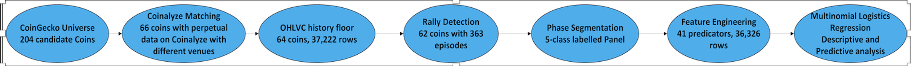
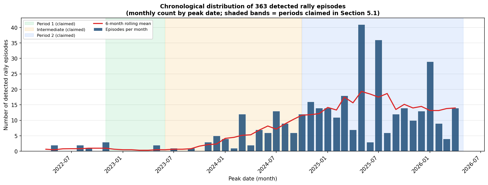
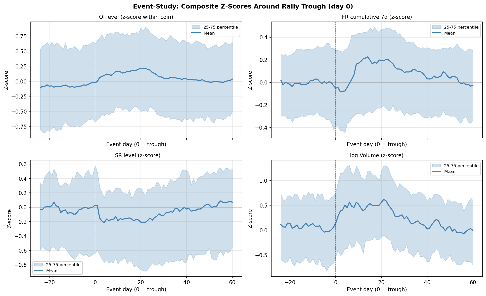
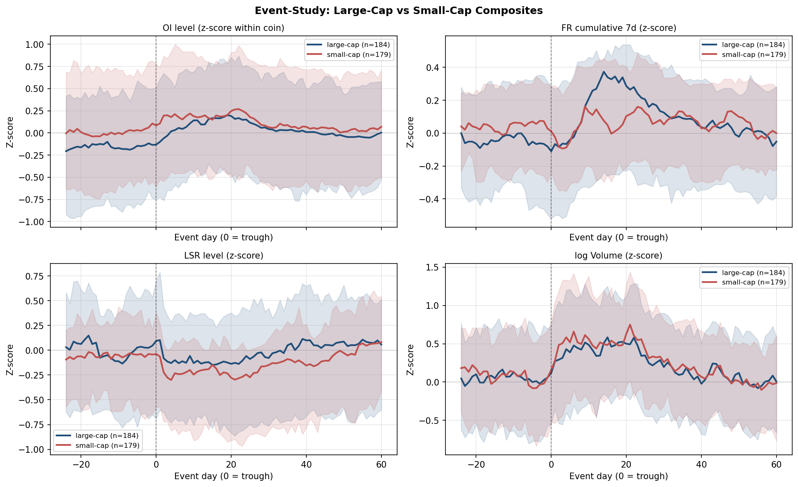
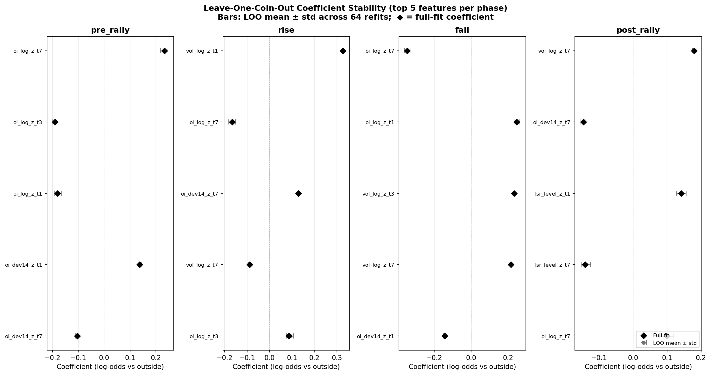

# Meme Coin Rally Detection & Derivative Market Analysis

**Master's Thesis Research | LUT University | Business Analytics | 2026**

*Rally Episodes in Meme Coin Perpetual Futures: A Rule-Based Detection and Derivative Market Characterisation*

## Project Overview

Meme coin markets are characterised by sharp price movements, speculative trading activity, and episodes of heightened volatility. This research investigates how rally episodes in meme coin perpetual futures can be identified systematically and how derivative-market activity changes throughout their lifecycle.

The study develops a transparent, rule-based detection method using price movements and time-based criteria to identify historical rally episodes. Each episode is decomposed into four phases: **pre-rally, rise, fall, and post-rally**, alongside an `outside` reference category.

Using multinomial logistic regression (MLR), the research examines the relationship between these phases and four derivative-market variables:

- Open interest
- Funding rate
- Long/short ratio
- Traded volume

Two model specifications are considered: a contemporaneous descriptive model and a lagged predictive model using observations from one, three, and seven days earlier. Price is deliberately excluded from the regression predictors because it is used to construct the historical phase labels.

The study uses data from **April 2022 to April 2026**, sourced from CoinGecko and Coinalyze.

## Research Highlights

| Research Measure | Result |
|---|---:|
| Meme coins with collected price data | 64 |
| Meme coins with detected rallies | 62 |
| Total rally episodes identified | 363 |
| Rally classification categories | 5 |
| Known historical rallies recovered | 20 of 26 |
| Historical rally coverage | 76.9% |

## Research Methodology

The analytical process consists of universe definition, historical data collection, rally detection, phase decomposition, derivative-market feature engineering, multinomial logistic regression, and model validation.

*Figure 1. Summary of the full analytical workflow.*

## Key Visualisations

### Chronological Distribution of Rally Episodes

*Figure 3. Monthly distribution of the 363 detected rally episodes based on their peak dates.*

### Derivative-Market Behaviour Around Rally Episodes

*Figure 4. Standardised event-study composites showing the behaviour of open interest, funding rate, long/short ratio, and traded volume around identified rally troughs.*

### Large-Cap and Small-Cap Comparisons

*Figure 5. Comparison of derivative-market patterns across large-cap and small-cap meme coins.*

### Model Robustness

*Figure 11. Leave-one-coin-out coefficient stability checks across the four in-episode phases.*

## Selected Findings

The rule-based detection framework identified **363 historical rally episodes across 62 meme coins**, recovering 76.9% of events in a separately assembled historical rally registry.

The multinomial regression analysis indicates that derivative-market variables provide information about differences between rally phases, with the relevance of individual features varying across lag horizons.

The thesis reports predictive macro-F1 of approximately **0.27**, compared with approximately **0.12** for a majority-class baseline. These results concern the classification of retrospectively determined phases and do not establish the performance of a live trading system.

## Tools and Technologies

**Python | Jupyter Notebook | pandas | NumPy | SciPy | scikit-learn | statsmodels | Matplotlib | requests | pycoingecko**

**Data Sources:** CoinGecko and Coinalyze.

## Research Notebook

[View the complete Jupyter notebook](Rally_Detection_Rule.ipynb)

The notebook presents the original Python implementation, research workflow, statistical analysis, visualisations, validation procedures, and data-quality investigations.

This repository is intended to showcase the research and analytical implementation rather than provide a fully configured application. Independent replication requires access to the relevant historical data, suitable API credentials, and local environment configuration.

## Full Master's Thesis

The complete academic thesis contains the literature review, methodological justification, detailed empirical results, interpretation, and limitations.

[Read the thesis through its permanent URN](https://urn.fi/URN:NBN:fi-fe20260708110050)

**LUT University — Master's Programme in Business Analytics, 2026**

## Research Scope and Limitations

Rally episodes are identified retrospectively using price and time criteria. The predictive model examines classification of these historical phase labels using lagged derivatives-market observations; its findings should not be interpreted as validated real-time trading signals.

The analysis also reflects limitations associated with historical data availability, exchange coverage, missing derivative-market observations, and modelling assumptions.

Google Trends integration is presented separately as an extension for future research.
